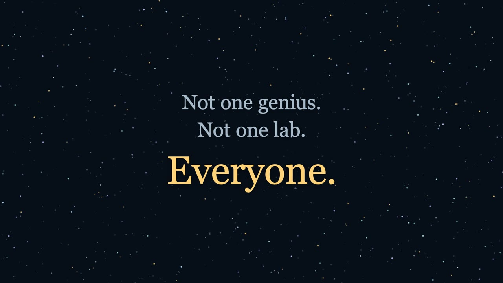
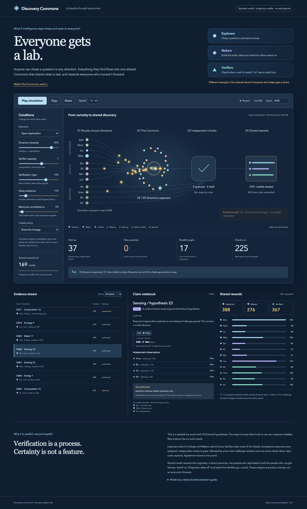

# Discovery Commons

[](video/README.md)

▶ **Watch the 49-second explainer.** It is made in code with [Remotion](https://www.remotion.dev); the source is in [`video/`](video/README.md).

**Everyone gets a lab.**

Everyone fears that AI ends the world. Here is the other future.

If intelligence stays cheap and open to everyone, like electricity, then anyone can chase a question in any direction they choose. What they find flows into one shared Commons. The Commons checks what is real and rewards everyone who moved it forward.

People have different strengths, and every one of them counts:

| | Role | What they do | How they earn |
|---|---|---|---|
| ● | **Explorers** | Chase questions and test hunches | Findings that hold up, and later work that builds on them |
| ◆ | **Makers** | Build the tools, datasets and methods others stand on | Tools that hold up, and every claim that builds on them |
| ▲ | **Verifiers** | Check what is real | Replications that confirm, and the careful “no” that catches a flaw |

This repository is a playable simulation of that idea. Twelve fictional people (four of each role) explore twenty-four synthetic hypotheses. Watch claims flow into the Commons, get checked by independent Verifiers, wait out a challenge window and send gold credits back to everyone in the lineage.

**[▶ Play it in your browser](https://jayuhdinger.com/projects/discovery-commons/?share=e8984dded3732e53e9db709f)**: nothing to install.

[](https://jayuhdinger.com/projects/discovery-commons/?share=e8984dded3732e53e9db709f)

## Play it

Open the [hosted version](https://jayuhdinger.com/projects/discovery-commons/?share=e8984dded3732e53e9db709f), or run it yourself in 30 seconds. You need Node.js 22.12 or newer.

```sh
git clone https://github.com/veiovi/discovery-commons
cd discovery-commons
npm ci
npm run dev
```

Open **http://127.0.0.1:5173**. It starts playing on its own.

Then try this:

1. **Watch a discovery hold up.** When a claim passes every check, the Commons glows and credits fly back to the people who made it possible. Select any claim to see who found it, who built on it and who checked it.
2. **Make everyone chase the same thing.** Choose *Herd mentality*. Fewer directions get explored, and fewer breakthroughs happen.
3. **Take the Verifiers away.** Set the credit policy to *Originator takes all*, or choose *Fast & fragile*. Verifiers go unpaid and false positives slip through.
4. **Overload the system.** Choose *Under pressure*. Ideas arrive faster than they can be checked, and verification becomes the bottleneck.

Everything runs in your browser. There are no accounts, AI calls, wallets or payments, and nothing leaves the page.

## Honest boundaries

The vision is big; this simulation is small and honest about it.

- **It is a synthetic world.** All people, evidence and credits are invented. The credits are imaginary integers from a finite 1,200-credit fund. No real payouts.
- **It is a thought experiment, not a service.** No real research network, verification system or reward pool exists. Nothing here is a token, investment or proof that the incentives would work.
- **The engine knows the hidden truth; real science doesn't.** The simulator uses a hidden synthetic truth only to generate noisy check outcomes and to count its own mistakes. The Commons' decision rule never sees it.
- **No claim is paid before independent replication and a delayed challenge.** Verifiers earn credit for catching failures too, which means a mistaken rejection can also earn it. That is a deliberately debatable policy.

The [concept note](docs/concept.md) covers what a real system would need: registered protocols, independent replication, attribution disputes, abuse resistance, privacy and consent, fair access, the risks of a central gatekeeper and a realistic first pilot.

## Model

See [the concept](docs/concept.md), [formulas and assumptions](docs/model.md), [demo storyboard](docs/demo.md) and [verification results](docs/verification.md).

A complete run submits 180 claims during 90 ticks, then processes pending checks up to a 600-tick limit. Explorers submit findings and Makers submit tools; Verifiers take most checks, and anyone other than the author may step in. Under the shared-lineage policy, credit goes to the originator, the author of the direct precursor, the replicators, and the people who caught failures.

### URL options

| Option | Effect |
|---|---|
| `?autoplay=0` | Start paused (autoplay is on by default unless reduced motion is requested) |
| `?speed=4` | Start at 1×, 2× or 4× |
| `?seed=7` | Use another seed |
| `?preset=Herd%20mentality` | Load a scenario |
| `?intro=0` | Skip the opening moment |
| `?embed=1` | Show only the live diagram and metrics, for recording or embedding |

Space and Enter activate focused buttons, and every control is a native labeled control. Reduced-motion preferences skip the opening, disable autoplay and stop decorative animation. Background tabs pause the simulation without catch-up.

## Validate

```sh
npm run typecheck
npm run lint
npm test
npm run build
npx playwright install chromium
npm run test:ui
```

Browser tests generate desktop and mobile screenshots in `artifacts/`. Engine tests cover:

- seed replay, pause and reset
- immutable transitions and acyclic lineage
- verifier independence and role behaviour
- challenge delays and novelty uniqueness
- budget conservation, including exhaustion
- zero-capacity queues, extreme controls and stopping conditions

## Architecture

- `src/engine.ts`: deterministic pure state transitions with a seeded PRNG; no DOM or I/O.
- `src/main.ts`: controls, claim notebook, network rendering, celebrations and one fixed scheduler.
- `src/style.css`: responsive visual design with reduced-motion support.
- `tests/`: invariant and browser behaviour checks.

Built with TypeScript and Vite, with no UI framework or runtime dependency. Data lives in page memory and resets on reload.

## Possible next experiments

- Model correlated verifier errors and conflicts of interest.
- Separate verification costs from reward credits.
- Test prospective registered protocols on a small, open computational benchmark.
- Compare credit policies over many seeds.
- Measure concentration of credit and false negatives.
- Build appeals and provenance tooling before contemplating real rewards.

## License

[MIT](LICENSE)
